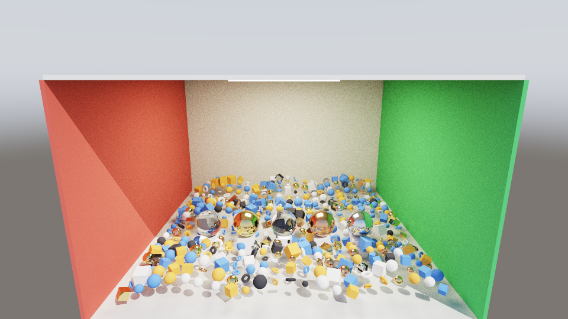
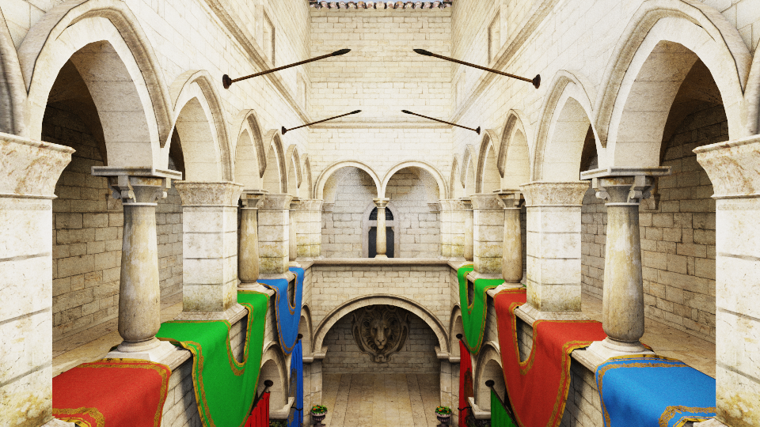
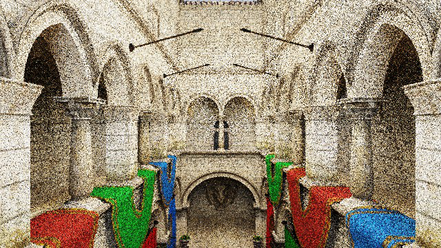

# RayTracingDemo

基于 **Vulkan 硬件光追** 的实时路径追踪 Demo，使用 ImGui 构建界面，支持程序化场景与 glTF 室内场景，逐帧累积收敛。

| 程序化场景 | Khronos Sponza |
| :---: | :---: |
|  |  |

## 特性

- **硬件光追路径追踪**：`VK_KHR_ray_tracing_pipeline` + `VK_KHR_acceleration_structure`，BLAS/TLAS + Shader Binding Table
- **双渲染后端**：Windows 默认 RT 管线；Android 默认 `compute + VK_KHR_ray_query`（兼容 Adreno 等仅暴露 ray query 的移动 GPU），设备支持时可在 UI 切换
- **迭代式弹射**：单 ray payload 内完成多跳（默认 4 跳），避免递归着色器与多 payload 开销
- **NEE 直接光照**：每跳对解析光源做一次采样，配合 GGX 重要性采样与余弦加权漫反射
- **材质系统**：metallic-roughness、法线贴图、Fresnel 玻璃、自发光、alpha mask
- **阴影射线**：使用 `rayQueryEXT`（`gl_RayFlagsOpaqueEXT`）做可见性测试，避免阴影 miss 着色器笔触
- **逐帧累积**：RGBA16F 辐射度 + RGBA32F 累积缓冲，compute shader 累加，相机移动时自动重置
- **降噪处理**：俄罗斯轮盘赌 + firefly clamp，ACES 色调映射 + gamma 校正
- **双场景**：程序化 ~500 实例波形阵列房间 / Sponza 室内 glTF 场景
- **RenderDoc 集成**：内置 In-Application API，可直接在程序内触发 `.rdc` 抓帧

## 渲染管线

每帧依次执行：

| 阶段 | 说明 |
| --- | --- |
| Ray Tracing | `path_tracer.rgen` 发射主射线，命中后执行迭代弹射与 NEE；`rayQuery` 做阴影测试 |
| Accumulate | `accumulate.comp` 把当前帧辐射度累加进历史缓冲 |
| Tonemap | `tonemap.frag` 采样累积结果，ACES 映射后输出到交换链 |
| UI | ImGui 覆盖层在同一个 render pass 内绘制 |

描述符集（set 0）：

| Binding | 资源 |
| --- | --- |
| 0 | TLAS |
| 1 | FrameConstants (UBO) |
| 2 / 3 | 全局顶点 / 索引缓冲 |
| 4 / 5 / 6 / 7 | Mesh / Instance / Material / Light SSBO |
| 8 | 纹理数组（128 层） |
| 9 / 10 | Radiance (RGBA16F) / Accumulation (RGBA32F) storage image |

## 依赖

所有第三方库均以 **git submodule** 引入并锁定版本：

| 库 | 版本 / commit |
| --- | --- |
| [imgui](https://github.com/ocornut/imgui) | `d88f238d` (v1.93.0-docking) |
| [glfw](https://github.com/glfw/glfw) | `3.5.1`（仅 Windows） |
| [volk](https://github.com/zeux/volk) | `vulkan-sdk-1.4.357.0` |
| [VulkanMemoryAllocator](https://github.com/GPUOpen-LibrariesAndSDKs/VulkanMemoryAllocator) | `3aa9212` |
| [glm](https://github.com/g-truc/glm) | `8d1fd52e` |
| [stb](https://github.com/nothings/stb) | `a7d4c217` |
| [tinygltf](https://github.com/syoyo/tinygltf) | `488a70a` |

## 构建

前置条件：

- Windows 10/11 + 支持硬件光追的 GPU（NVIDIA RTX / AMD RX 6000+ / Intel Arc）
- Vulkan SDK 1.4.x（需包含 `glslc`，CMake 会从 `%VULKAN_SDK%/Bin` 查找）
- Visual Studio 2026（生成器 `Visual Studio 18 2026`）或 CMake 3.28+

```powershell
git clone --recurse-submodules https://github.com/GlambertsQY/RayTracingDemo.git
cd RayTracingDemo

cmake --preset vs2026
cmake --build --preset release
```

生成的可执行文件位于 `build/Release/RayTracingDemo.exe`，编译后的 SPIR-V 会自动复制到同目录 `shaders/` 下。也可以直接打开 `build/RayTracingDemo.sln`。

### Android（arm64-v8a）

前置条件：

- JDK 17
- Android SDK Platform 35、Build-Tools 35.0.0
- NDK `27.2.12479018`、CMake `3.22.1`
- Vulkan SDK（提供 `glslc`；也可使用 NDK 的 shader-tools）
- 支持 Vulkan 1.3 + `VK_KHR_acceleration_structure` + `VK_KHR_ray_query` 的真机

```powershell
$env:JAVA_HOME = "C:\Program Files\Microsoft\jdk-17.0.20.101-hotspot"
$env:ANDROID_HOME = "$env:LOCALAPPDATA\Android\Sdk"
$env:Path += ";$env:ANDROID_HOME\platform-tools"

cd android
.\gradlew.bat :app:assembleRelease
```

产物为 `android/app/build/outputs/apk/release/app-release.apk`（使用调试签名，可直接 `adb install`）。日常调试可改用 `:app:assembleDebug`。`assets/Sponza` 存在时会自动打包进 APK；SPIR-V 在构建时嵌入原生库，不依赖 APK 资产路径。

## 场景资产

Sponza 模型不随仓库分发，首次运行前请执行：

```powershell
powershell -ExecutionPolicy Bypass -File scripts/fetch_assets.ps1
# 或
cmake --build build --target fetch_assets
```

脚本从 KhronosGroup/glTF-Sample-Assets 下载约 50 MB 贴图与 glTF 到 `assets/Sponza/`。若未下载，`--scene sponza` 会回退到程序化场景。

## 运行

```powershell
build\Release\RayTracingDemo.exe
build\Release\RayTracingDemo.exe --scene sponza --width 1600 --height 900
```

| 参数 | 说明 |
| --- | --- |
| `--scene <procedural\|sponza>` | 选择场景，默认 `procedural` |
| `--width <n>` / `--height <n>` | 初始窗口尺寸 |
| `--frames <n>` | 渲染指定帧数后自动退出（配合截图/抓帧使用） |
| `--screenshot <path>` | 退出前保存当前帧 PNG |
| `--renderdoc-capture` | 在第 3 帧触发 RenderDoc 抓帧 |

Windows 调试时设置环境变量 `RTDEMO_COMPUTE=1` 可强制使用 ray query compute 后端，用于对比两种渲染路径。

操作：`左键` 轨道旋转、`右键` 平移、`滚轮` 缩放、`F1` 显示/隐藏 UI。UI 面板可实时调整弹射次数、每帧采样数、渲染缩放、曝光、太阳方位/高度、环境光强度、firefly clamp 等。

Android 运行：

```powershell
adb install -r android\app\build\outputs\apk\debug\app-debug.apk
adb shell am start -n com.raytracingdemo.android/android.app.NativeActivity
adb logcat -s RayTracingDemo
```

Android 操作：`单指` 旋转、`双指` 平移、`捏合` 缩放、`返回键` 切换 UI。默认渲染缩放 0.5、2 次弹射、NEE 1 跳、1 spp；启动日志会打印 GPU、Vulkan 版本、可用的光追扩展与最终后端。

Android 性能（骁龙 8 Elite Gen 5 / Adreno 840 实测，1304×600 渲染）：程序化场景约 200–250 FPS；Sponza（26 万三角形）约 33–36 FPS。可在 UI 中调整 `Max bounces`、`NEE bounces` 和 `Render scale` 进一步取舍画质与帧率；建议使用 `assembleRelease` 构建以获得最佳性能。

## RenderDoc 抓帧

启用 `--renderdoc-capture` 后，程序通过 `RENDERDOC_GetAPI` 在第 3 帧自动开始/结束抓帧，输出到工作目录下的 `captures/rdoc_capture.rdc`。该功能需要：

- 安装 RenderDoc（CMake 自动探测 `renderdoc_app.h`，找不到则编译期关闭，源码中由 `RTDEMO_HAVE_RENDERDOC` 控制）
- 使用 RenderDoc 的 `qrenderdoc` 或 MCP 服务打开 `.rdc` 分析各 Pass 耗时与资源绑定



## 已知限制

- 累积渲染在低采样数下仍有轻微噪点，需要多帧收敛
- 阴影射线使用 `rayQuery` 并标记为 opaque，alpha mask 材质在阴影中按不透明处理
- Android compute 路径的主射线同样按不透明处理，alpha mask 仅影响材质外观
- Android 默认使用 `compute + VK_KHR_ray_query` 后端；设备不支持 ray query 时无法运行
- Android 不支持 RenderDoc 抓帧与命令行截图，验证时使用 `adb exec-out screencap`
- 移动端默认 0.5 渲染缩放、2 次弹射、NEE 1 跳；Sponza 负载较重，可继续降低渲染缩放
